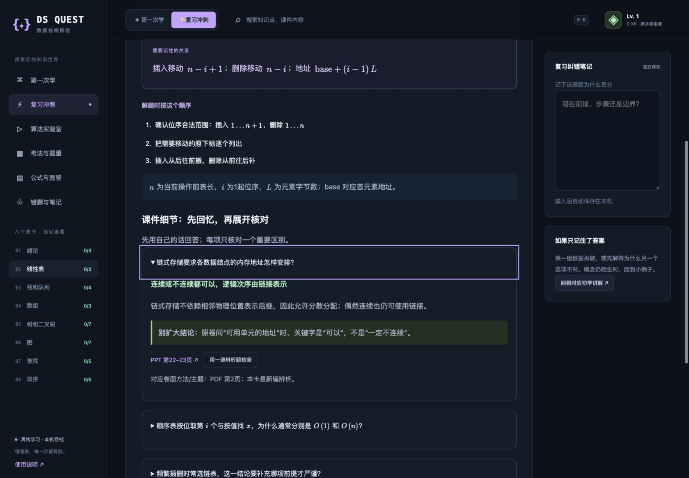
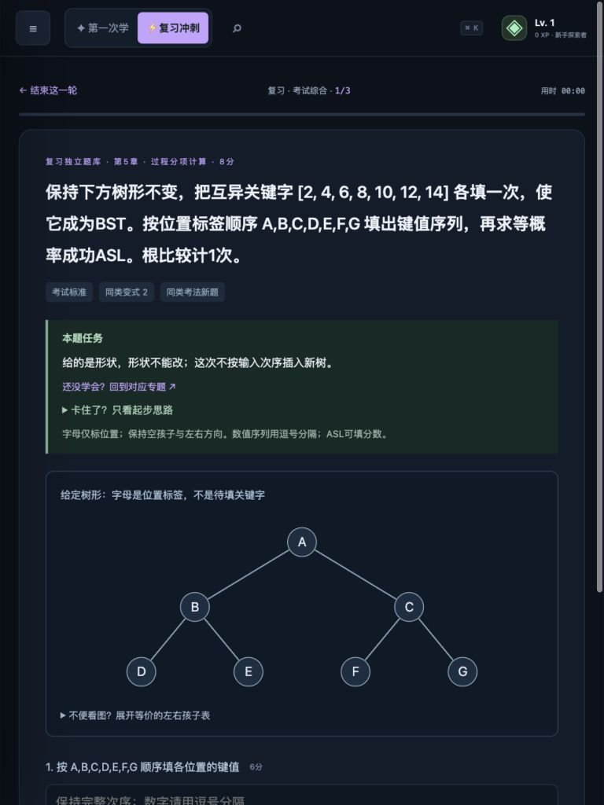

# DS Quest · 数据结构学习与复习站

**第一次学，先看懂一个小例子；考前复习，再练完整解题过程。**

一个中文、离线可用的数据结构学习网站。把初学与复习分成两条独立路线，配合图解、算法演示、分层练习和错题记录，减少“看过定义，却不知道怎么做题”的距离。

[在线体验](https://ivozhengyi.github.io/ds-quest/) · [下载离线版](https://github.com/ivozhengyi/ds-quest/releases/latest) · [反馈问题](https://github.com/ivozhengyi/ds-quest/issues) · [建站 Skill](https://github.com/ivozhengyi/course-learning-site)



## 两条路线，各做一件事

| | 第一次学 | 复习 |
| --- | --- | --- |
| 内容 | 55 个小目标教程，从术语、具体例子到图示与课堂小练 | 37 个独立专题，回忆重点、核对公式条件、整理解题步骤 |
| 练习 | 120 题，基础 → 迁移 → 小挑战 | 371 题、125 个题族，概念、过程与综合训练 |
| 节奏 | 默认热身围绕已学与当前知识，不突然跳到后面的概念 | 按章节、层次、题型、未练和错题组合训练 |
| 记录 | 学习进度、笔记与作答独立保存 | 复习进度与训练记录独立保存 |

覆盖绪论、线性表、栈与队列、数组、树、图、查找和排序。另有 68 项重点回忆、25 个预设算法演示，以及按有限样卷结构编排的 100 分训练模拟。

- **看过程**：播放、暂停、单步观察算法，配合本题数据的中间过程表。
- **知道错在哪**：选择题逐项反馈；公式解释变量、下标和适用前提。
- **保留学习线索**：搜索、收藏、笔记、错题、进度与 JSON 存档备份。
- **离线也能学**：无构建步骤，无账号依赖；KaTeX 0.16.22 与字体本地提供。

<details>
<summary>查看平板练习界面</summary>



</details>

## 开始使用

直接打开[在线版](https://ivozhengyi.github.io/ds-quest/)，或下载 Release 压缩包，解压后双击 `index.html`。也可以下载仓库的 ZIP；整个文件夹一起保留即可。

本地分别打开 `第一次学.html`、`复习冲刺.html` 可直接进入对应路线。桌面和平板均可使用。

学习记录保存在当前浏览器/来源中，不会自动跨设备同步。换浏览器、清理数据或改变打开地址前，请在网站中导出存档；本地文件的保存行为受浏览器限制。

## 判分与训练边界

自动题支持数值、序列和列明的等价输入；多空题按空给分。代码、画图及综合论述采用**自评**，自动得分和自评分分开显示；待自评时总分不完整。查看答案不会被称为自动判对。

参考解答经过推导和程序检查，但不是官方答案。等长最短路接受多条合法路径；哈夫曼等多解任务需按题目条件和评分点核对。近期正确率、经验和模拟分是训练反馈，不保证真实考试成绩。

## 公开版包含什么

公开版保留讲解、练习、演示、判分和学习记录功能。**不包含第三方课件原件、试卷扫描件及其逐页提取全文**。资料按钮显示来源说明，原参考页号仅作为开发索引。无需这些原件也能使用教学和训练功能。

训练优先级来自开发时核对的有限样卷和课程范围，不能解释为其他学校或下一次考试的命题预测。详见[公开版说明与检查](docs/PUBLIC-EDITION.md)。

## 开发与验证

运行需要 Node.js；网站本身不需要 Node.js。

```bash
node 维护/verify_banks.cjs
node 维护/verify_pedagogy.cjs
node 维护/verify_curriculum.cjs
node 维护/verify_graph_answers.cjs
node 维护/verify_math.cjs
node 维护/verify_state.cjs
```

`维护/` 中保留题库生成与检查来源。题库、教学、课程覆盖、图算法独立复算，以及公式和存档分别检查；CI 执行同一组检查。自动检查不能代替内容审读和真实浏览器验收。

## 参与改进

欢迎反馈“哪一句没看懂”、具体错题、多解判分或平板操作问题。请附页面/题目 ID 与依据，见 [贡献说明](CONTRIBUTING.md)。

如果希望接收版本更新，可在仓库 **Watch → Custom → Releases** 订阅；只想收藏项目也可以 Star。后续改进会以实际完成的 Release 说明为准。

## License

项目自有代码与编写内容采用 [MIT](LICENSE)。KaTeX 保留其 [MIT 许可](assets/katex/LICENSE)；本项目不授予未分发的第三方课件、教材或试卷的权利。
